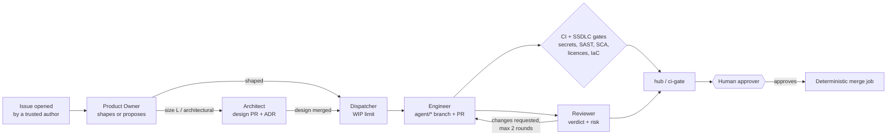

# Agent Squad HQ

**An AI software team that runs in your GitHub organisation.** Open an issue in plain language. A squad of agents shapes it, designs it, threat-models it, builds it, reviews it and runs the security gates. Humans approve at the gates they choose. No agent can merge or deploy.

<!-- Badges: placeholders until the public repository and its workflows exist. -->
[](https://github.com/berasoftware/agent-squad-hq/actions/workflows/hub-ci.yml)
[](LICENSE)
[](https://securityscorecards.dev/viewer/?uri=github.com/berasoftware/agent-squad-hq)

> **Status: alpha (0.1.0, unreleased).** The Actions-mode pipeline, the configuration CLI and the SSDLC gates are the most exercised parts. Server mode, the non-Anthropic executors, the non-GitHub trackers and the dashboard and mobile apps are newer and less proven. See [Project status](#project-status) before you rely on any of it.

## How it works

One **hub** repository holds the prompts, the configuration and the reusable workflows. Each project repository carries only its code, its memory files (`CLAUDE.md`, `docs/adr/`, `docs/lessons.md`) and a short `agents.yml` stub that forwards GitHub events to the hub.



- Agents run inside GitHub Actions, through `anthropics/claude-code-action`, with a per-job, least-privilege GitHub App token and a tool allowlist.
- A deterministic job, not a model, decides whether a PR may merge. The default is `approvers`: an organisation owner or member must approve every PR.
- Risk is `max(model risk, path-based floor)`. A model can raise risk but can never lower it below what the changed files imply.
- Text from issues, PRs, comments, diffs and the web is treated as untrusted data and fenced before it reaches a model.

## Quickstart (Actions mode, about 15 minutes)

Requirements: Python 3.11+, the [`gh` CLI](https://cli.github.com/) logged in as an organisation owner, a GitHub organisation, and an Anthropic API key. See [docs/getting-started/requirements.md](docs/getting-started/requirements.md).

```bash
# 1. Make this repository your hub (any name; agent-squad-hq is the default)
git clone https://github.com/berasoftware/agent-squad-hq acme-squad-hub && cd acme-squad-hub
gh repo create acme/agent-squad-hq --private --source . --push

# 2. Install the CLI (PyPI publishing starts with v0.1.0; until then install from source)
python -m pip install -e .            # later: pipx install agent-squad-hq

# 3. Write squadhq.yml, create the GitHub App, set variables, labels and rulesets
squadhq init                          # interactive; prints a dry run
squadhq init --create-app --apply     # does it

# 4. Model credential (never put it in squadhq.yml)
gh secret set ANTHROPIC_API_KEY --org acme --visibility all

# 5. Generate the runtime files, commit, onboard a project, check everything
squadhq render && git add -A && git commit -m "chore: squad config" && git push
squadhq onboard acme/storefront --apply
squadhq doctor
squadhq drill --repo acme/storefront --apply

# Hosted / token-broker installs: only the admin repo settings (no squadhq.yml); dry run unless --apply
squadhq repo-settings --hub acme/agent-squad-hq --project acme/storefront --apply
```

Then open an issue in `acme/storefront` describing what you want. The full walkthrough is [docs/getting-started/quickstart-actions-mode.md](docs/getting-started/quickstart-actions-mode.md).

## Features

**Pipeline**
- Product Owner intake, team-thread assessment for unclear asks, Architect design PRs with ADRs, Engineer implementation on `agent/*` branches, Reviewer verdicts with a bounded fix loop (2 rounds by default), and a mention handler for `@squad` (and `@claude`) in issues and PRs.
- A label-driven state machine defined in [`config/flows.yml`](config/flows.yml), with a deterministic stuck-ticket sweeper, ticket transitions on merge, a hub janitor and optional GitHub Projects board sync.
- Scheduled jobs: Chief of Staff, Daily Brief, Weekly Rollup, debt scans, a quarterly architecture review, and Growth, SEO, Legal and Finance department agents (each can be switched off).
- A catalogue of more than 80 skills (threat modelling, security review, release management, incident response and more) with manifests, prompts and evals. See [docs/skills/CATALOGUE.md](docs/skills/CATALOGUE.md).
- 17 stack packs (Java/Spring, Node, Next.js, React, Python/FastAPI and Django, Go, .NET, Rust, PHP/Laravel, Rails, Flutter, React Native, Swift, Kotlin/Android, Terraform, Docker/Kubernetes) that add build commands, review rules, debt rules and risk paths.

**SSDLC gates on every PR** (each one configurable)
- Secrets (gitleaks), SAST (Semgrep, new findings only), SCA (OSV-Scanner, newly introduced vulnerabilities), dependency licences (deny list or allow list) and IaC (Trivy config) on pull requests, plus a CycloneDX SBOM attached to each published release of a project.
- One required check, `hub / ci-gate`, that works out which checks applied to the PR and whether they passed. Fork PRs still get CI and gates, but no agent job.

**Models and executors**
- Hub loops call models through provider adapters: Anthropic, OpenAI, Azure OpenAI, Google Gemini, AWS Bedrock and OpenAI-compatible servers (Ollama, vLLM, LM Studio, OpenRouter, Together), with retry and cross-model fallback.
- Coding agents in Actions mode run on Claude Code. Output normalisers and tool-profile translations exist for Codex CLI, Gemini CLI and aider, but those executors are not wired into Actions mode yet.

**Trackers and code hosts**
- GitHub Issues in Actions mode. Adapters for Jira Cloud, Linear, Trello and GitLab Issues, with status maps, are used by server mode.

**Server mode (self-host)**
- A FastAPI service with signed webhook intake (GitHub, Jira, Linear, Trello, GitLab), a leader-elected timezone-aware scheduler, a queue worker, SQLite or Postgres state, a hash-chained audit log, bearer-token roles, Prometheus metrics and optional OpenTelemetry. Docker Compose, a Helm chart and Terraform examples for AWS, GCP and Azure. See [docs/deploy/](docs/deploy/docker-compose.md).

**Dashboard and mobile (preview)**
- A Next.js dashboard and an Expo app for approvals, runs, costs and briefs, both clients of the server API. Neither has been released. See [docs/apps/dashboard.md](docs/apps/dashboard.md) and [docs/apps/mobile.md](docs/apps/mobile.md).

## Project status

| Area | Status |
|---|---|
| `squadhq` CLI: `init`, `validate`, `render`, `doctor`, `onboard`, `drill` | Implemented and unit-tested; `render --check`, pack, skill and eval validation run in hub CI |
| Actions-mode router, gates, merge policy, sweeper | Implemented; inherited from an earlier private deployment and since hardened. Workflow lint (actionlint, zizmor) runs in CI |
| Provider adapters (hub loops) | Implemented and tested against recorded fixtures; live use beyond Anthropic is not yet proven |
| Executors other than Claude Code | Normalisers and tool profiles only; not runnable in Actions mode |
| Server mode | Implemented and tested in-process; deployment examples are validated (`helm lint`, `terraform validate`) but not applied to real accounts |
| Non-GitHub trackers | Adapters tested against fixtures; reachable through server mode only |
| Dashboard, mobile app | Preview; mobile builds have not been run |
| Cloud and Enterprise editions | Planned, not built. See [docs/editions.md](docs/editions.md) |

Some `squadhq.yml` keys are validated and rendered but not yet enforced by the runtime (for example per-run budgets). The [configuration reference](docs/configuration/squadhq-yml.md) marks each one.

## Documentation

- [Documentation home](docs/index.md) (build the site with `mkdocs serve`)
- [Architecture](docs/concepts/architecture.md) · [Security model](docs/security/security-model.md) · [Threat model](docs/security/threat-model.md)
- [squadhq.yml reference](docs/configuration/squadhq-yml.md) · [Variables and secrets](docs/configuration/variables-and-secrets.md)
- [Roadmap](docs/ROADMAP.md) · [Changelog](CHANGELOG.md)

## Contributing and security

Contributions are welcome under the [Developer Certificate of Origin](CONTRIBUTING.md#developer-certificate-of-origin). Please read [CONTRIBUTING.md](CONTRIBUTING.md) and the [Code of Conduct](CODE_OF_CONDUCT.md). Report vulnerabilities, including prompt-injection bypasses, privately as described in [SECURITY.md](SECURITY.md). Do not open a public issue.

## Licence

Apache License 2.0. See [LICENSE](LICENSE) and [NOTICE](NOTICE). Maintained by Bera Software & Consultancy Ltd.
