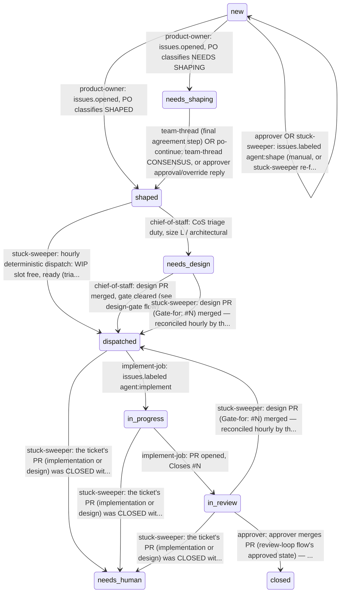
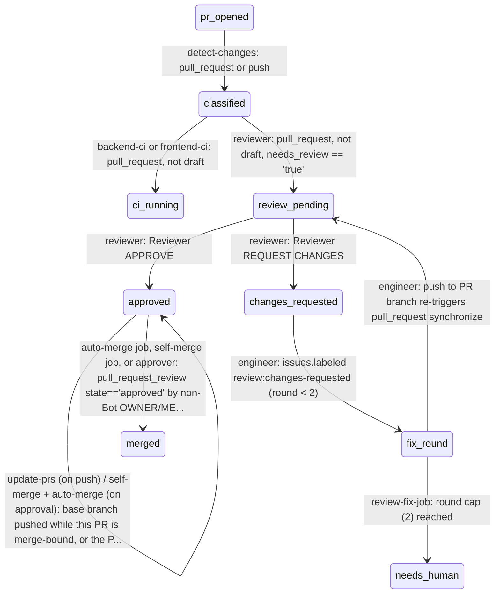
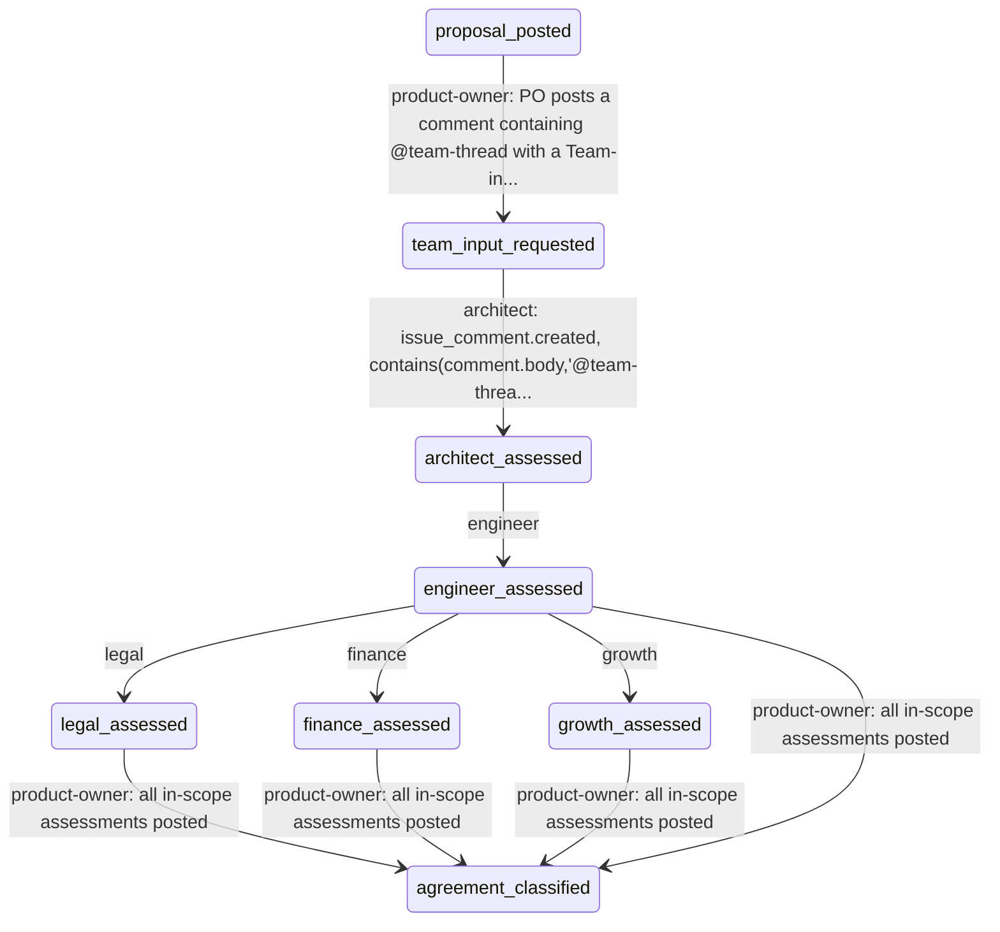
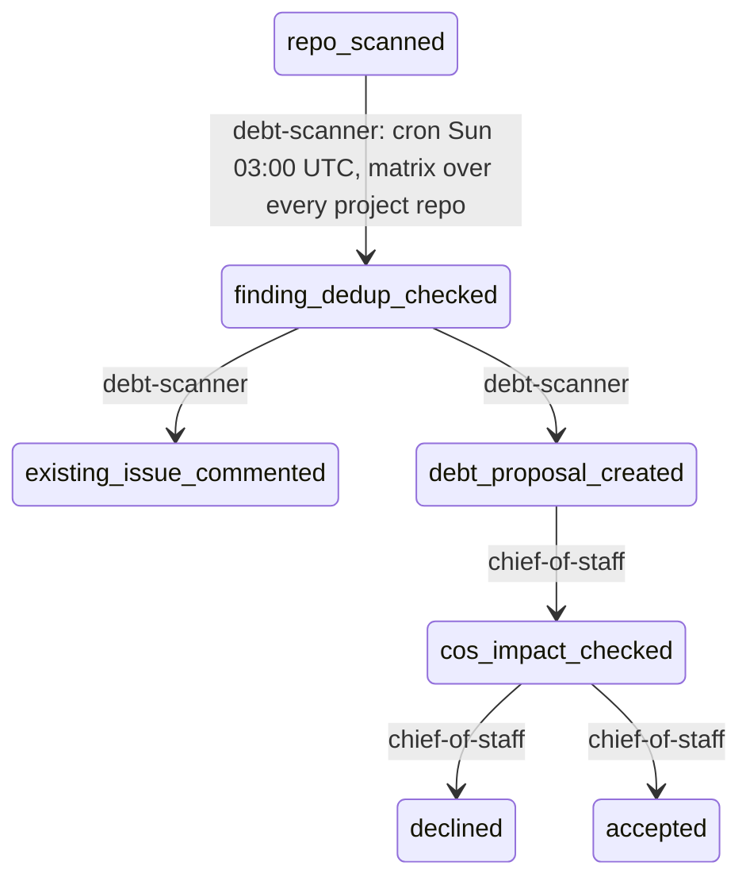
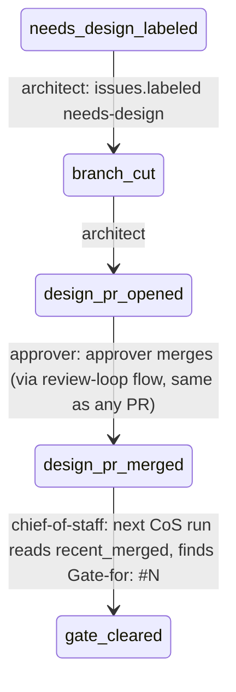
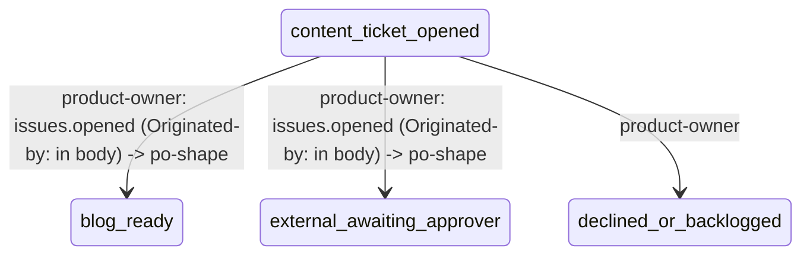
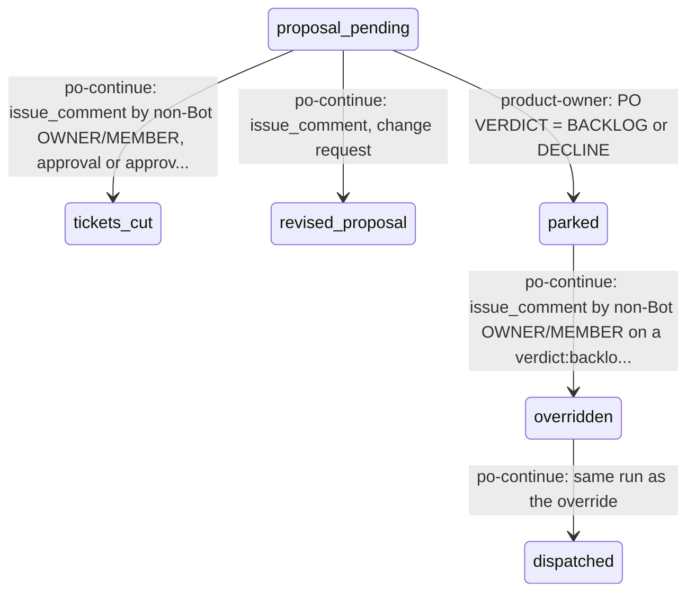

# Flow diagram

**Auto-generated from `config/flows.yml` by `squadhq.flow_diagram` — do not hand-edit this file.** Regenerate after any `config/flows.yml` change: `python -m squadhq.flow_diagram`. CI regenerates it automatically (see `.github/workflows/flow-definition.yml`) and fails the check if this file is out of date with the committed flows.yml.

## ticket-lifecycle

A ticket's life from a plain issue to a merged/closed PR, covering both the approver-authored and self-actuated (Originated-by:) paths.

## review-loop

A PR's life from open to merged, including the bounded 2-round automated fix loop.

## team-thread

Collaborative assessment round for a NEEDS SHAPING proposal — Architect + Engineer always, Legal/Finance/Growth conditional on the PO's own Team-input-scope: line. Never runs for a SHAPED ticket (proportional, not a blanket tax).

## debt-intake

Weekly tech-debt scan -> dedup-or-propose -> CoS accept/decline. Lives almost entirely OUTSIDE router.yml — tech-debt-weekly.yml + CoS duty 3. Debt-proposal issues deliberately carry no Originated-by: line so po-shape's widened bot-exclusion condition does not pull them into PO intake (see ticket-lifecycle's `new` state — this flow bypasses it).

## design-gate

needs-design -> Architect's design PR (Gate-for: #N) -> merge -> CoS clears the gate -> agent:implement. Mostly CoS duty 6, not router.yml, once the design PR itself is open.

## content-flow

Growth/SEO content -> project-repo ticket carrying channel:blog or channel:external + Originated-by: -> po-shape validates (positioning, claims, duplicate posts) -> blog: normal ticket-lifecycle (Engineer PR adds the post); external: awaiting-approval, approver posts by hand and closes.

## override-flow

Approver overrides a PO verdict, or approves/changes a NEEDS SHAPING proposal, outside the team-thread CONSENSUS path.

## Label states — issues

Which labels an open issue carries in each state. Only these state labels count: `proposal:pending`, `triaged:ready`, `debt-proposal`, `debt`, `needs-design`, `agent:implement`, `status:in-progress`, `status:in-review`, `needs-human`. Everything else (dept, priority, verdict, channel, risk) is metadata. **Any combination not listed is illegal** — the stuck sweeper repairs it if a rule below covers it, otherwise escalates it with `needs-human`.

| State labels | Flow state | Meaning |
|---|---|---|
| *(none)* | `ticket-lifecycle.new` | unshaped ticket, or not a ticket at all (report, content draft) |
| `proposal:pending` | `ticket-lifecycle.needs_shaping` | PO proposal awaiting team-thread / approver |
| `triaged:ready` | `ticket-lifecycle.shaped` | shaped; the sweeper dispatches it into a free WIP slot |
| `debt-proposal` | `debt-intake.debt_proposal_created` | debt finding awaiting CoS intake |
| `debt` | `debt-intake.accepted` | accepted debt; dispatched like triaged:ready |
| `needs-design` | `ticket-lifecycle.needs_design` | Architect owes a design PR |
| `needs-design` + `status:in-progress` | `ticket-lifecycle.in_progress` | Architect writing the design |
| `needs-design` + `status:in-review` | `ticket-lifecycle.in_review` | design PR open |
| `agent:implement` | `ticket-lifecycle.dispatched` | Engineer dispatched, not started |
| `agent:implement` + `status:in-progress` | `ticket-lifecycle.in_progress` | Engineer working |
| `agent:implement` + `status:in-review` | `ticket-lifecycle.in_review` | PR open (or report delivered) |
| `status:in-review` | `ticket-lifecycle.in_review` | report ticket delivered, waiting for the approver to close it |
| `needs-human` | `ticket-lifecycle.needs_human` | approver's call |

**Modifiers** — ride along on any state above without changing it:

- `needs-human` — parked on the approver; the underlying state is kept for when it is lifted
- `debt` — accepted tech debt — a kind of ticket, so it rides along once dispatched

**Automatic repairs** (first match wins; every group needs one label present):

| When | Unless | Action | Why |
|---|---|---|---|
| (`verdict:backlog` or `verdict:decline` or `P3`) AND (`agent:implement` or `needs-design` or `triaged:ready`) | `verdict:overridden` | escalate (`needs-human`) | parked (backlog/decline/P3) AND dispatched — either the park or the dispatch is wrong, and that is the approver's call. |
| (`debt-proposal`) AND (`triaged:ready`) | `verdict:backlog`, `verdict:decline`, `P3` | remove `debt-proposal`, `triaged:ready`; add `debt` | a `debt-proposal` marked `triaged:ready` is accepted debt — relabelled to `debt` so it can dispatch. |
| (`debt-proposal`) AND (`debt`) | — | remove `debt-proposal` | already accepted as `debt` — the proposal label is stale. |
| (`proposal:pending`) AND (`triaged:ready`) | `agent:implement`, `needs-design` | escalate (`needs-human`) | both `proposal:pending` (needs shaping) and `triaged:ready` (shaped) — the PO has to settle which. |
| (`triaged:ready` or `debt-proposal`) AND (`agent:implement` or `needs-design`) | — | remove `triaged:ready`, `debt-proposal` | already dispatched — `triaged:ready` is the step before dispatch. |
| (`proposal:pending`) AND (`agent:implement` or `needs-design`) | — | remove `proposal:pending` | already dispatched — the proposal stage is over. |

**Fact-dependent repairs** (which label wins depends on PR state; `squadhq.stuck_sweeper` normalize_issue):

- `agent:implement` + `needs-design`: design PR merged -> remove `needs-design`; otherwise remove `agent:implement` (design first)
- `status:in-progress` + `status:in-review`: PR open -> remove `status:in-progress`; otherwise remove `status:in-review`

## Label states — PRs

Which labels an open PR carries in each state. Only these state labels count: `ready-to-merge`, `review:changes-requested`, `needs-approver-merge`, `needs-human`, `status:in-progress`, `status:in-review`. Everything else (dept, priority, verdict, channel, risk) is metadata. **Any combination not listed is illegal** — the stuck sweeper repairs it if a rule below covers it, otherwise escalates it with `needs-human`.

| State labels | Flow state | Meaning |
|---|---|---|
| *(none)* | `review-loop.review_pending` | opened — CI and review pending (or review in progress) |
| `review:changes-requested` | `review-loop.changes_requested` | Reviewer asked for changes; the fix round runs |
| `ready-to-merge` | `review-loop.approved` | Reviewer approved; self-merge deciding, or auto-merge armed and waiting on ci-gate |
| `ready-to-merge` + `needs-approver-merge` | `review-loop.approved` | approved but not auto-mergeable (risk above low, human-authored, failed check) — waiting on the approver's click |
| `needs-human` | `review-loop.needs_human` | approver's call |

**Exclusive** — metadata labels of which at most one may be present:

- `risk:low` / `risk:medium` / `risk:high`

**Modifiers** — ride along on any state above without changing it:

- `needs-human` — parked on the approver (fix-round cap hit, stuck re-fires); the review state is kept

**Automatic repairs** (first match wins; every group needs one label present):

| When | Unless | Action | Why |
|---|---|---|---|
| (`status:in-progress` or `status:in-review`) | — | remove `status:in-progress`, `status:in-review` | `status:*` labels track the ISSUE; on a PR they are noise the board and readers misread. |
| (`needs-approver-merge`) | `ready-to-merge` | remove `needs-approver-merge` | `needs-approver-merge` without an approval (`ready-to-merge`) is stale. |

**Fact-dependent repairs** (which label wins depends on PR state; `squadhq.stuck_sweeper` normalize_pr):

- `ready-to-merge` + `review:changes-requested`: latest verdict wins (label events): newer REQUEST CHANGES -> remove `ready-to-merge` and `needs-approver-merge`; newer APPROVE -> remove `review:changes-requested`
- two or more `risk:*`: keep the most recently applied risk label (the Reviewer's latest verdict), remove the rest
