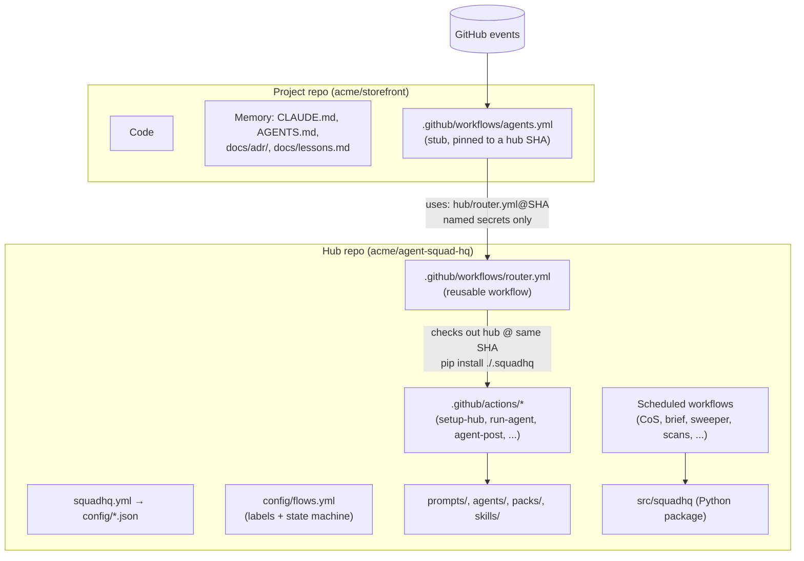
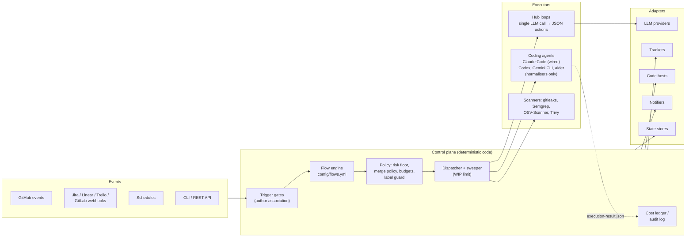

# Architecture

Agent Squad HQ separates a **control plane**, which decides what should happen, from **executors**, which do the work, and **adapters**, which talk to the outside world. The same Python package (`squadhq`) runs in two runtimes: GitHub Actions (Actions mode) and a self-hosted service (server mode).

## Hub and stub

- A **project** carries only its code, its memory files and the stub. The stub lists the GitHub events the router needs and passes five named secrets (`SQUADHQ_APP_PRIVATE_KEY`, `ANTHROPIC_API_KEY`, `CLAUDE_CODE_OAUTH_TOKEN`, `OPENAI_API_KEY`, `GEMINI_API_KEY`). It never uses `secrets: inherit`.
- The **hub** holds everything else. `router.yml` is a reusable workflow; every job checks the hub out to `.squadhq/` at the SHA the stub pinned, installs the package, and sets `SQUADHQ_HOME`.
- Scheduled work (Chief of Staff, briefs, sweeps, scans) runs in the hub's own workflows and acts across all registered projects.

See [flows and labels](flows-and-labels.md) for how events become work, and [upgrading](../getting-started/upgrading.md) for how the pin moves.

## Control plane, executors and adapters

### Control plane

Plain Python and workflow conditions, no model in the loop:

| Concern | Where |
|---|---|
| Which events may start an LLM job | `if:` conditions in `router.yml` (author association, bot identity, fork check, disabled jobs) |
| Label registry, states, transitions, role authority, limits | `config/flows.yml`, read by `squadhq.flow_reader` |
| Dispatch, stuck-ticket recovery, WIP limit | `squadhq.stuck_sweeper`, `squadhq.ticket_transition` |
| Risk floor | `squadhq.policy.risk` |
| Merge decision | `squadhq.merge_policy` and the `self-merge`, `auto-merge`, `trivial-merge` jobs |
| Which labels a role may apply | `squadhq.label_guard` |
| Tool allowlists | `squadhq.executors.tool_profiles` |
| Model per job, fallback, capacity | `squadhq.resolve_model`, `squadhq.capacity_gate`, `squadhq.failure_handler` |
| Cost | `squadhq.cost_ledger` (coding agents), `state/usage.json` (hub loops) |
| Hygiene | `squadhq.hub_janitor`, `squadhq.stub_sync`, `squadhq.board_sync` |

### Executors

- **Coding agents** work in a checkout with tools: implement, review, review-fix, design, mention, product owner, team thread, debt scans, the quarterly review and most catalogue skills. In Actions mode the `run-agent` composite action runs `anthropics/claude-code-action` (pinned by SHA) with a model from `config/models.json`, a tool allowlist built from a [tool profile](../security/security-model.md#tool-profiles), and a separate least-privilege GitHub App token. Its output is normalised into a neutral `ExecutionResult` ([ADR-0004](../adr/0004-neutral-execution-result.md)). Normalisers for Codex CLI, Gemini CLI and aider exist, but `run-agent` refuses any executor other than `claude-code` today.
- **Hub loops** (`python -m squadhq.agent_runner <mode>`: `cos`, `brief`, `rollup`, `growth`, `seo`, `legal`, `finance`) gather context with `gh`, make one model call through the [provider registry](providers.md), and execute a JSON list of actions limited to creating issues, commenting, adding or removing labels and closing issues, each checked against the role's authority in `flows.yml`. They cannot push code or merge.
- **Scanners** run as ordinary CI jobs. See [SSDLC](../security/ssdlc.md).

### Adapters

All adapters implement the protocols in `src/squadhq/interfaces.py` and are picked through a registry in their subpackage:

| Kind | Implementations | Used by |
|---|---|---|
| `LLMProvider` | Anthropic, OpenAI, Azure OpenAI, Gemini, Bedrock, OpenAI-compatible (Ollama, vLLM, LM Studio, OpenRouter, Together, generic) | Hub loops, evals |
| `IssueTracker` | GitHub, Jira Cloud, Linear, Trello, GitLab | Server mode (Actions mode uses `gh` and GitHub Issues directly) |
| `CodeHost` | GitHub (token or App), GitLab | Server mode |
| `Notifier` | GitHub issue, Slack, Teams, email, webhook, PagerDuty, Expo push | `python -m squadhq.notify`, server mode |
| `StateStore` | SQLite, Postgres | Server mode |

## The two runtimes

| | Actions mode | Server mode |
|---|---|---|
| Event intake | The project stub (GitHub events) | `POST /api/v1/webhooks/{github,jira,linear,trello,gitlab}`, signature-checked |
| Scheduling | GitHub cron, rendered to UTC by `squadhq render` | `squadhq server scheduler`, leader-elected, evaluates local time in `org.timezone` |
| State | Labels and issues in GitHub, `state/*.json` in the hub, ledger issues | SQLite or Postgres with compare-and-set, a job queue with leases |
| Coding jobs | GitHub-hosted runners | `byo-compute`: dispatch the hub's `squadhq-agent.yml` in the project; `worker`: sandboxed container |
| Audit | Workflow logs, cost-ledger issues, escalation issues | Hash-chained `audit_events` table, `GET /api/v1/audit/verify` and `/audit/export` |

The REST API is described in [CONVENTIONS](../architecture/CONVENTIONS.md#server-rest-api-v1). Deployment is covered in [self-hosting](../deploy/docker-compose.md).

## Design decisions

The main decisions are recorded as [ADRs](../adr/index.md).
