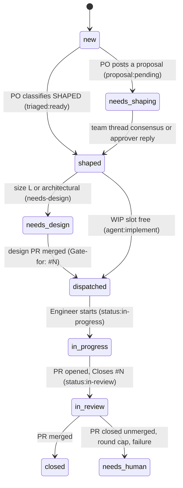
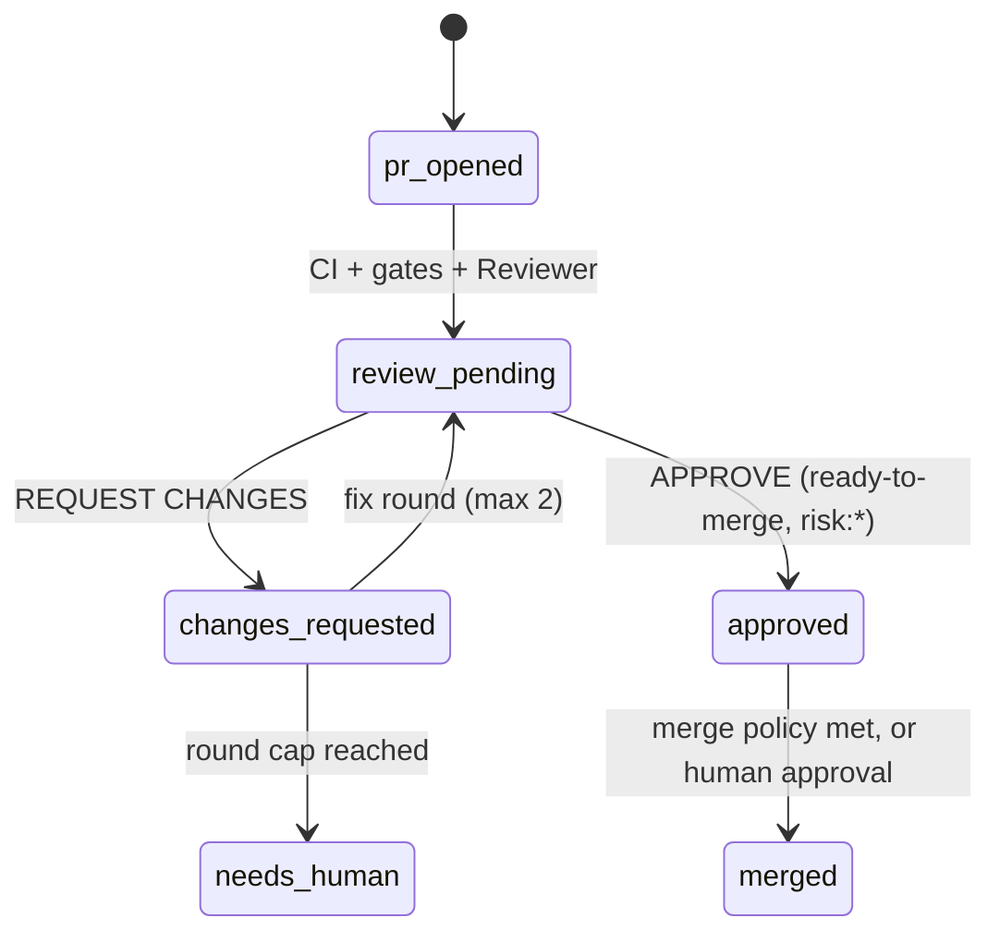

# Flows and labels

Agent Squad HQ is driven by GitHub labels. A label records where a ticket or PR is, and adding certain labels starts a job. The single source of truth for every label, state, transition, role authority and numeric limit is [`config/flows.yml`](https://github.com/bera-software/agent-squad-hq/blob/main/config/flows.yml). Hub CI validates it with `python -m squadhq.flow_reader validate --strict`, and the [generated flow diagram](../FLOW-DIAGRAM.md) is rebuilt from it.

`flows.yml` is an engine file that ships with each release ([ADR-0003](../adr/0003-single-config-file.md)). You normally configure behaviour through `squadhq.yml` instead of editing it.

## Who may trigger what

Whether an event may start an LLM job is decided by workflow conditions, never by a model ([ADR-0007](../adr/0007-untrusted-input.md)):

| Event | Job | Condition |
|---|---|---|
| Issue opened | `po-shape` (Product Owner) | Author association in `SQUADHQ_TRUSTED_ASSOCIATIONS` (default `OWNER,MEMBER,COLLABORATOR`), or the bot itself with an `Originated-by:` line |
| Issue opened by anyone else | `external-triage` | No model. Adds `needs-triage` for a human |
| Comment with the trigger phrase (`@squad`, or `@claude`) | `mention`, or a catalogue skill for `@squad <command>` | Trusted association, human author, not on a PO-flow issue |
| Reply on a `proposal:pending` / `verdict:*` issue | `po-continue` | Trusted association |
| Label `agent:implement` | `implement` | Applying a label needs triage access to the repository |
| Label `needs-design` | `design` | As above |
| Label `review:changes-requested` | `review-fix` | As above; round cap 2 |
| Label `ready-to-merge` | `self-merge` (deterministic) | As above |
| PR opened or updated | CI, gates, `review` | Not a draft; the review is skipped for docs-only, trivial, base-only and fork PRs |
| PR review "approved" | `auto-merge` (deterministic) | Human reviewer with association in `SQUADHQ_MERGE_ASSOCIATIONS` (default `OWNER,MEMBER`) |
| Push to the default branch | `ticket-transition`, `update-prs`, `board` | Deterministic |
| Deployment status success on a preview | `qa-preview` | Environment name contains `SQUADHQ_PREVIEW_ENVIRONMENT` (default `Preview`) |

Any of these jobs can be switched off by listing its job key in `SQUADHQ_DISABLED_AGENTS` (see [variables](../configuration/variables-and-secrets.md#agents-and-gates)).

## The main flows

### Ticket lifecycle

- **Shaping.** The Product Owner either classifies a clear, single deliverable as SHAPED (`triaged:ready`) or posts a proposal (`proposal:pending`). An unclear proposal gets a short **team thread**: the Architect and Engineer always assess it, and Legal, Finance and Growth when the PO's scope line asks for them.
- **Dispatch.** The stuck sweeper (deterministic, hourly by default) and the Chief of Staff add `agent:implement` while the project has fewer than the WIP limit of open PRs (5, from `flood-guards.wip_limit_open_prs_per_project` in `flows.yml`). You can add the label yourself.
- **Dependencies.** A ticket body line `After: #N` makes the Engineer wait for #N; `squadhq.ticket_transition` re-dispatches it when #N merges.
- **Design gate.** A design PR carries `Gate-for: #N`. When it merges, the gate clears and the ticket is dispatched.

### Review loop

The Reviewer applies a `risk:low|medium|high` label. The [merge and risk policy](merge-and-risk-policy.md) then decides who merges.

### Other flows

`flows.yml` also defines the **team thread**, **debt intake** (weekly debt scans propose `debt-proposal` issues that the Chief of Staff accepts or declines), the **design gate**, the **content flow** (Growth and SEO drafts that wait for `awaiting-approval`) and the **override flow** (an approver overriding a backlog or decline verdict). All are drawn in the [flow diagram](../FLOW-DIAGRAM.md).

## Label groups

| Group | Labels | Notes |
|---|---|---|
| Dispatch | `agent:implement`, `needs-design`, `agent:shape`, `agent:continue` | Adding one starts a job |
| Status | `status:in-progress`, `status:in-review`, `ready-to-merge`, `needs-approver-merge`, `review:changes-requested`, `needs-human`, `escalation` | `needs-human` stops automation until a person acts |
| Lifecycle | `triaged:ready`, `proposal:pending`, `debt`, `debt-proposal`, `awaiting-approval` | |
| Verdict | `verdict:proceed`, `verdict:backlog`, `verdict:decline`, `verdict:overridden` | The PO's audit trail |
| Risk | `risk:low`, `risk:medium`, `risk:high` | Applied by the Reviewer; see the [risk floor](merge-and-risk-policy.md#risk-floor) |
| Security | `needs-threat-model`, `security:review-required`, `security:approved`, `gate:sast`, `gate:sca`, `gate:secrets` | Start security skills or record gate results |
| Operations | `incident`, `epic`, `question`, `needs-dpia`, `questionnaire`, `pentest:requested` | Start catalogue skills. `pentest:requested` is applied only by humans |
| Priority | `P0` to `P3` | |
| Department and channel | `dept:*`, `channel:blog`, `channel:external`, `report` | |
| Hub only | `daily-brief`, `weekly-rollup`, `project:<name>` | Created in the hub repository |

Each label in `flows.yml` has an `applied_by` list. The [label guard](../security/security-model.md#label-guard) stops an agent role from adding a label it does not own. Labels are created with fixed colours by `squadhq init --apply` and by onboarding.

## Limits

`flows.yml` `flood-guards` holds the numeric limits the runtime reads: the WIP limit, the review-fix round cap, the Chief of Staff's actions per run (20), self-actuated tickets per run (3), debt findings per scan (5), the capacity-trip pause (60 minutes), the failure-handler retry cap and others. Each entry names the code or prompt that enforces it.

## Recovery

Nothing waits forever. `squadhq.stuck_sweeper` (schedule key `stuck_sweeper`) finds tickets and PRs waiting on automation past a threshold and re-fires exactly the event they wait for: it re-adds `agent:shape`, `agent:continue` or `agent:implement`, re-posts a team-thread trigger, or escalates to `needs-human`. The **hub janitor** de-duplicates escalation issues and retires old reports in the hub.
