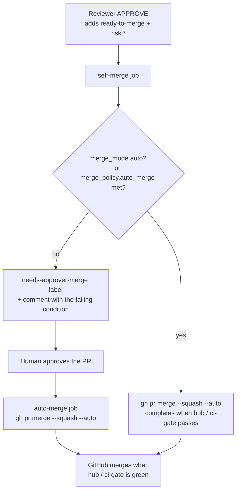

# Merge and risk policy

No agent can merge. Every merge is started by a deterministic workflow job using the bookkeeping App token, after a policy check written in code ([ADR-0005](../adr/0005-agents-never-merge-or-deploy.md)). The tool profiles deny `gh pr merge` and the merge API to every agent.

## Who merges



- **Human approval.** When a person whose association is in `SQUADHQ_MERGE_ASSOCIATIONS` (default `OWNER,MEMBER`) approves a PR, the `auto-merge` job enables GitHub auto-merge (squash). GitHub completes it once the ruleset's required check `hub / ci-gate` passes. Bot approvals never count.
- **Reviewer approval.** When the Reviewer applies `ready-to-merge`, the `self-merge` job evaluates the policy. If it is not met, the PR gets `needs-approver-merge` and a comment naming the first failing condition, so a skip is never silent.
- **Trivial merge.** A bot-authored PR whose every changed file matches `merge_policy.trivial_paths` in `config/flows.yml` (by default `graphify-out/**` and `docs/FLOW-DIAGRAM.md`) skips review and is merged once CI passes. One non-matching file sends it down the normal path. The file list is checked twice: in `detect-changes` and again in `squadhq.merge_policy`.

Repositories need **Allow auto-merge** and **Allow squash merging** turned on.

## Merge modes

Set `policies.merge.mode` in `squadhq.yml`, or `projects[].merge_mode` for one project.

| Mode | Behaviour today | Use when |
|---|---|---|
| `approvers` (**default**) | A person with an association in `SQUADHQ_MERGE_ASSOCIATIONS` (default `OWNER,MEMBER`) approves every PR. (`org.approvers` is rendered but not yet used for this check.) The `self-merge` job only arms auto-merge if `merge_policy.auto_merge` in `config/flows.yml` is enabled and met, and it ships **disabled**. | Always, unless you have met the prerequisites below |
| `risk_based` | Rendered the same way as `approvers` today: `config/projects.json` gets the runtime value for approver merging plus a `merge` block with your `risk_based` settings, which the router does not read yet. Low-risk automatic merging comes from `merge_policy.auto_merge` in `flows.yml`. | You want low-risk agent PRs to merge without a click, and you have met the prerequisites |
| `auto` | The `self-merge` job arms auto-merge for **every** PR the Reviewer approves. Branch protection's required checks are the only gate. `squadhq validate` warns. | Not recommended. Only on a hub-protected default branch with SAST, SCA and secret scanning required |

### What `merge_policy.auto_merge` checks

The evaluator in `squadhq.merge_policy` **fails closed**: a condition it cannot evaluate (missing label, failed API call, unparseable `flows.yml`, or a condition key with no evaluator) counts as not met. All of these must hold:

1. The Reviewer's verdict is APPROVE.
2. The PR carries `risk:low`.
3. The deterministic final risk is `low` (see the [risk floor](#risk-floor)).
4. No check on the PR is failing.
5. The PR author is a bot (agent-authored work only).

### Prerequisites for opting in to automatic merging

Before you set `merge_policy.auto_merge.enabled: true` in `config/flows.yml` (and `policies.merge.mode: risk_based` to record the intent):

- [ ] Every project's default branch has the `squadhq` ruleset requiring `hub / ci-gate`, with no bypass for the App. `squadhq doctor --check rulesets` verifies it.
- [ ] `SQUADHQ_GATES` includes at least `secrets,sast,sca` (the default is `secrets,sast,sca,license,iac,sbom`).
- [ ] The packs you use declare `risk_paths` for your security-sensitive code, and you have checked `python -m squadhq.packs risk-globs --repo <repo>`.
- [ ] You are comfortable that the Reviewer's `risk:low` label plus a `low` path floor is enough for your change classes. Everything in the [risk floor](#risk-floor) list still needs a human.
- [ ] You keep `flows.yml` changes in your hub under review: it is an engine file and upgrades may change it.

These `squadhq.yml` settings are validated and rendered, but **not yet enforced** by the merge evaluator: `policies.merge.risk_based.max_risk`, `require_checks`, `require_security_agent`, and `policies.merge.always_human`. Today automatic merging is limited to `low` risk regardless of `max_risk`, and the areas in `always_human` (`auth`, `payments`, `migrations`, `workflows`, `infra`, `deps-major`) are already forced to `high` by the core risk floor below, so they never merge automatically.

## Risk floor

Final risk is `max(llm_risk, path_floor)` ([ADR-0006](../adr/0006-deterministic-risk-floor.md)). The Reviewer can raise risk; it can never lower it below what the changed files imply. `squadhq.policy.risk` forces `high` for any changed path matching:

| Class | Examples of matching globs |
|---|---|
| Security-sensitive code | any path containing `auth`, `oauth`, `oidc`, `saml`, `jwt`, `login`, `password`, `credential`, `security`, `crypto`, `encrypt`, `signing`, `permission`, `rbac`, `payment`, `billing`, `checkout`, `invoice`, `stripe`, `wallet`, `secret` |
| Schema migrations | `**/migrations/**`, `**/*.sql`, `**/alembic/**`, `**/flyway/**`, `**/liquibase/**`, `**/schema.prisma` |
| Dependency manifests and lockfiles | `package.json`, lockfiles, `pom.xml`, `build.gradle*`, `pyproject.toml`, `uv.lock`, `go.mod`, `Cargo.toml`, `Gemfile`, `*.csproj`, `pubspec.yaml` and more |
| CI/CD definitions | `.github/workflows/**`, `.github/actions/**`, `CODEOWNERS`, `dependabot.yml`, `.gitlab-ci.yml`, `Jenkinsfile`, `.circleci/**` |
| Infrastructure and containers | `*.tf`, `helm/**`, `k8s/**`, `Dockerfile`, compose files, `vercel.json`, `fly.toml`, `netlify.toml`, `serverless.yml` |
| Secrets and environment config | `.env*`, `*.pem`, `*.key`, `application*.yml`, `appsettings*.json`, `config/production*`, `*.sops.*` |

Matching is case-insensitive and deliberately over-inclusive (`**/*auth*` also matches `AUTHORS.md`): a false `high` costs one human click, a false `low` could ship an unreviewed auth change. Packs add their own `risk_paths`.

Try it locally:

```bash
git diff --name-only main... > changed.txt
python -m squadhq.policy.risk --files-from changed.txt --llm-risk low --json
```
