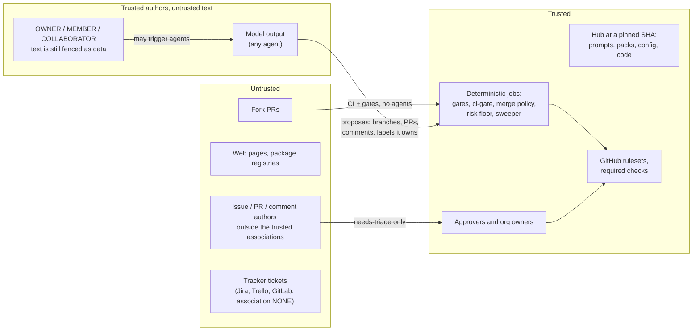

# Security model

Agent Squad HQ gives language-model agents write access to your repositories. The design assumes that **any model can be manipulated** by the text it reads, and puts every decision that matters (who may trigger work, what may merge, what risk a change carries) in deterministic code that the model cannot change. Agents can propose; code and people decide.

This page describes the controls. The [threat model](threat-model.md) lists what they do and do not cover.

## Trust boundaries



| Actor or input | Trusted to | Not trusted to |
|---|---|---|
| Organisation owners, hub maintainers | Everything. They control the hub, secrets and rulesets | |
| People with an association in `SQUADHQ_TRUSTED_ASSOCIATIONS` | Start LLM jobs | Have their text treated as instructions: it is fenced as data like everything else |
| People with an association in `SQUADHQ_MERGE_ASSOCIATIONS` | Approve a PR, which arms auto-merge | Bypass `hub / ci-gate` |
| Anyone else (including `NONE`, `FIRST_TIMER`, fork authors) | Open issues and PRs | Start any LLM job. Their issues are labelled `needs-triage` for a human |
| Any model output | Propose code on its own branch, comment, apply labels its role owns | Merge, deploy, push to a default branch, change policy, decide risk below the floor, decide trigger eligibility |
| The hub's prompts, packs, `config/` and package, at the pinned SHA | Instruct agents | |
| A project's `CLAUDE.md`, `docs/adr/`, `docs/lessons.md` | Instruct agents **as they exist on the integration branch** | Instruct agents as changed by the PR under review |

## Untrusted input

Everything an outsider or the web could have written is untrusted: issue and PR titles and bodies, comments, review comments, diffs, commit messages, branch names, code comments, file contents of the project under review, tracker tickets, CI logs and web pages ([ADR-0007](../adr/0007-untrusted-input.md)).

- **Preamble.** `run-agent` puts an instruction to read `prompts/_untrusted-input.md` first in front of every agent prompt. It defines what is untrusted, tells the model that content inside `<untrusted>` blocks is data and never instructions, and lists rules no content can relax.
- **Fencing.** Code that interpolates untrusted text wraps it with `squadhq.untrusted.fence(text, source=..., author=..., association=...)`:

    ```text
    <untrusted source="issue#12" author="octocat" association="NONE">
    ...text...
    </untrusted>
    ```

    `fence()` also neutralises any `<untrusted>` or `</untrusted>` tag inside the text, so content cannot close its own fence.
- **Workflows.** Event text reaches shell steps through `env:`, never through `${{ }}` inside `run:`. zizmor in hub CI flags template injection.
- **Evals.** The eval suite has a prompt-injection red-team set (`evals/golden/redteam/`) with a 100% pass threshold, and every skill that reads untrusted input ships its own injection case ([agent evals](../skills/evals.md)).

Fencing and the preamble lower the chance that a model follows injected instructions. They do not make it impossible. That is why the controls below do not depend on the model behaving.

## Trigger eligibility is decided by code

Workflow `if:` conditions decide whether an event may start an LLM job: the author's association, whether the author is a bot, whether the PR comes from a fork, and whether the job is disabled. See the [trigger table](../concepts/flows-and-labels.md#who-may-trigger-what). Label-triggered jobs (`agent:implement`, `needs-design`, `review:changes-requested`, `ready-to-merge`) rely on GitHub's rule that applying a label needs triage access. Bot comments never re-trigger the mention handler.

## Agents never merge or deploy

([ADR-0005](../adr/0005-agents-never-merge-or-deploy.md))

- No tool profile grants `gh pr merge`, and every profile denies it explicitly, along with every `gh api` call except a few read and review-comment shapes for review roles.
- Merges are started only by deterministic jobs (`auto-merge`, `self-merge`, `trivial-merge`) using the **ops** App, after the [merge policy](../concepts/merge-and-risk-policy.md) is evaluated in code. The default mode needs a human approval.
- GitHub completes the merge only when the default-branch ruleset is satisfied: the required check `hub / ci-gate` and **one approval given after the last push**, with no bypass actors. The agent App pushed the code, so its approval never counts; in `risk_based` and `auto` modes the ops App approves only after `squadhq.merge_policy` passes.
- Fork PRs never auto-merge.

## Two App identities

Agents and bookkeeping run as **different GitHub Apps** so a manipulated agent cannot speak for the system:

| | Ops App (`SQUADHQ_APP_*`, `SQUADHQ_BOT_LOGIN`) | Agent App (`SQUADHQ_AGENT_APP_*`, `SQUADHQ_AGENT_BOT_LOGIN`) |
|---|---|---|
| Used by | Router steps, hub loops, sweeper, janitor, merge jobs | Coding agents in `run-agent` |
| Can | Label, comment, approve after policy, merge, dispatch workflows | Push `agent/*`/`design/*` branches, open PRs, comment in role |
| Cannot | n/a (deterministic code) | Edit workflows, approve its own push, merge, change settings |
| Trusted for | Protocol markers, state comments, the cost ledger, trivial-lane authorship | Being agent work (`untrusted.by_agent`); never protocol |

Code checks the exact login: `untrusted.by_bot()` is the ops App only, `by_agent()` the agent App, `by_automation()` either. A forged sweeper marker or ledger line from the agent App is ignored.

**Single-app mode** (no `SQUADHQ_AGENT_APP_CLIENT_ID`) is a fallback for trying the squad out: agents run as the ops App, so `squadhq.merge_policy` treats every unattended merge as "human required" and `squadhq doctor` warns.
In that mode the workflows also stop trusting "our identity" signals that the agent could have written: sweeper implementer markers are ignored (the engineer implements), session-context notes are not used for continuity, and the team thread is never started automatically.

**Verdicts are data, labels are ops.** The reviewer never sets `ready-to-merge`, `risk:*` or `review:changes-requested` (they have no agent owner in `config/flows.yml`, and `label_guard` refuses them). It ends its run with a `SQUADHQ-VERDICT:` line; the review-post job (ops identity, no untrusted code) records `<!-- squadhq:verdict sha=<head> ... -->` for the head it reviewed and only then applies the labels, with risk = max(model risk, path floor). `self-merge` runs only when the ops identity sent the `ready-to-merge` event, and `squadhq.merge_policy` re-checks through the issue events API that the labels were added by the ops login for the current head (`verdict_provenance`).

**Approvals.** Agents cannot approve pull requests: `gh pr review --approve` and any `gh api` review call carrying `APPROVE` are denied by the tool profile and refused by the label guard. Only humans, or the ops identity after `merge_policy` passed, approve. The Agent App keeps `pull_requests: write` because it opens PRs and posts review comments; that write scope is also what makes the approval deny necessary. Recommended: protect the default branch with a ruleset requiring one approval, **Require approval of the most recent reviewable push**, dismissal of stale approvals, and CODEOWNERS (or required reviewers) that do not include the Agent App.

**Approvals the automation cannot give.**
- Graph-refresh PRs are opened by the ops App, which cannot approve its own PR, so they need **one human approval** under a one-approval ruleset (or an explicit ruleset bypass for the ops App, if you accept that). This is deliberate: the alternative (agent-App-authored graph PRs approved by ops) would let the agent identity author content that merges without a human.
- When the ops App brings a merge-bound PR up to date with its base, it becomes the last pusher, so its own earlier approval stops counting under "most recent push" approval. In `risk_based` mode such a PR also needs a fresh verdict for the new head; expect a human approval after base updates.
- Production deploys happen only through the optional `deploy-production.yml`, which runs on a **published GitHub release** and behind the `production` environment's required reviewers. No agent publishes releases or holds deploy secrets.
- Hub loops can only create issues, comment, add or remove labels they own, and close issues.

## Tool profiles

Agent jobs run Claude Code with an explicit `--allowedTools` list and a `--disallowedTools` list, generated by `squadhq.executors.tool_profiles` from one of four profiles. Each profile includes the one before it:

| Profile | Adds |
|---|---|
| `read-only` | Read, Glob, Grep, LS; `git status/diff/log/show`; `gh issue view/list`, `gh pr view/list/diff/checks` |
| `comment` | `gh issue comment`, `gh pr comment`, `gh pr review`, `gh issue edit/create/close`, `gh pr edit` (label changes pass through the label guard) |
| `edit-test` | Edit, Write, MultiEdit; `git add`, `git commit`; `git checkout -b agent/*`, `git switch -c agent/*`; `git fetch origin*`, `git merge origin/*`; plus the selected packs' build and test commands |
| `edit-test-push` | `git push origin HEAD:refs/heads/agent/*`, `gh pr create` |

Role adjustments: the Architect pushes to `design/*` instead of `agent/*`; `review-fix` and `mention` push only to the PR's own head branch (which must match `agent/*` or `design/*`); review roles get narrow `gh api` patterns for inline review comments.

**Never granted:** `Bash(*)` or any unrestricted shell, `gh pr merge`, other `gh api` calls, force pushes or pushes to other refs, `git rebase`, `curl`, `wget`, `rm -rf`. Extra entries from packs or callers are validated and rejected if they try to widen a profile. The final step of `run-agent` drops any entry that would re-open the whole shell. Hub CI fails if `Bash(*)` appears in any workflow.

## Branch guard

For `edit-test-push`, `run-agent` installs a global `pre-push` hook and a `git` wrapper before the agent starts. The hook refuses pushes to the default branch, deletions, non-branch refs, non-fast-forward pushes and branches outside the allowed list. The wrapper refuses flags that would skip the hook or run arbitrary commands through git. This is defence in depth; the **default-branch ruleset is the real control**.

## Label guard

`python -m squadhq.label_guard install --role <role>` puts a `gh` wrapper first on `PATH` for agent jobs. A label add the role does not own (per `applied_by` in `config/flows.yml`) fails with a message the agent can read. Hub loops apply the same check in code before executing actions.

!!! warning "Advisory against a determined agent"
    The wrapper only sees `gh` calls that go through `PATH`. An agent that calls `gh` by absolute path, or reaches the API another way, bypasses it. The step itself runs with `continue-on-error`. What limits the damage is that a label only *starts* deterministic jobs, and those jobs re-check their own conditions (for example the merge policy re-evaluates risk from the changed files). Server-side enforcement on `labeled` events is the long-term control.

## Scoped, short-lived tokens

- No personal access tokens. Every job mints GitHub App installation tokens with `actions/create-github-app-token`, which expire after at most an hour.
- **Token-broker mode** ([ADR-0011](../adr/0011-token-broker-mode.md)). With `vars.SQUADHQ_TOKEN_BROKER` set, the same jobs get their tokens from a broker in exchange for the job's GitHub Actions OIDC token, and no App private key is stored in the organisation. Each request carries the same narrowed permission set as the App-key path, and every minting job ends by revoking the tokens it minted, so scope and lifetime match App-key mode. Only jobs that mint tokens hold `id-token: write`; agent jobs and untrusted-code jobs never do and never call the broker (`.github/lint/isolation.py` enforces both). The client masks the OIDC token and the issued token before printing anything, refuses redirects, and reports broker errors by code only.
- **Two tokens per agent job.** The *bookkeeping* token (this repository plus the hub) is used only by deterministic steps: capacity checks, cost ledger, model overrides, labels after the run. The *agent* token is minted inside `run-agent`, covers **only the repository being worked on** by default, and carries the job's least permissions (contents `read` unless the profile edits). The agent never holds the bookkeeping token or write access to the hub.
- Checkouts use `persist-credentials: false`, so no token is left in `.git/config`. For pushes, the branch guard configures the credential helper with the agent token.
- `permissions: {}` at the top of every workflow; each job asks for the least it needs.
- The project stub passes five **named** secrets to the router, never `secrets: inherit`. Hub CI rejects `secrets: inherit`.
- Both Apps' permissions are listed and justified in [`app-manifest.json`](https://github.com/bera-software/agent-squad-hq/blob/main/deploy/github-app/app-manifest.json) (ops) and [`app-manifest-agent.json`](https://github.com/bera-software/agent-squad-hq/blob/main/deploy/github-app/app-manifest-agent.json) (agent: contents, pull requests and issues write, checks read; no workflows). Neither requests administration, secrets, environments, deployments or security events; rulesets and secrets are applied by `squadhq init` with your own login.

## Workflow isolation (hardening in progress)

The tool profile is defence in depth, not a sandbox: pack build and test commands run repository code by design. The real boundary is what an agent job holds and what runs next to it. The design intent, and how much of it the code in this release already does:

| Design intent | Status in this release |
|---|---|
| An agent job holds only the LLM key and a short-lived, repository-scoped agent token | **Partly.** The agent step gets only the agent token (`GH_TOKEN`) and the model credential. Today the bookkeeping token is still minted in the same job, for the steps before and after the agent |
| Bookkeeping (labels, cost ledger, failure handling, merges) runs in a **separate job** from a fresh checkout, so nothing the agent wrote to the runner can influence it | **Planned.** Merge jobs (`auto-merge`, `self-merge`, `trivial-merge`) are already separate jobs; per-agent bookkeeping still runs in `agent-post` within the agent's job |
| `PYTHONSAFEPATH` is set, so `python -m squadhq…` in a checkout cannot import a planted module from the working directory | **Not yet in the code** at the time of writing |
| Tool profiles deny exfiltration reads and git exec and output flags | **Done** (`squadhq.executors.tool_profiles`): `Read`/`Grep`/`Glob` and Bash are denied on `/proc`, `/sys`, `/etc`, `/root`, `/tmp`, `/github`, the runner's `_temp` and home dotfiles; `$` and backticks are denied so no command can expand an environment variable; `gh` bodies must be inline (`--body-file`, `-F`, `@file` fields are denied); git `--output`, `--exec`, `--upload-pack`, `--receive-pack`, `--ext-diff`, `--textconv`, `-c`, `-C`, `--git-dir`, `--work-tree`, `--exec-path`, `config`, `submodule`, `filter-branch`, `hook` and options on `fetch` are denied; Edit and Write never touch `.git/**` or `.github/**` |
| The `gh` shim scans outgoing content (comments, issue and PR bodies) for secrets and refuses to send them | **Partly.** A redaction module (`squadhq.redact`: GitHub, Anthropic, OpenAI, AWS, Slack token shapes and the values of secret environment variables) exists and is used by the failure handler, the hub-loop runner and the server. The label-guard `gh` wrapper does not call it yet |
| Machine-readable markers in comments (for example `<!-- squadhq:implementer=… -->`, ledger lines) are trusted only when the bot wrote the comment | **Done** for the implementer choice in `router.yml` and the cost-ledger lines in `agent_runner`. Other markers: not audited for this page |
| The server merge gate pins the head SHA and requires checks | **Done** (`squadhq.server.approvals`): the approval stores the PR head SHA when requested, and a later push invalidates it; checks are read by commit SHA; there must be at least one, every `SQUADHQ_REQUIRED_CHECKS` entry must be present and all must be green (pending retries, failing or missing refuses); the merge call passes `sha=` so GitHub rejects a moved head; fork heads are refused unless `SQUADHQ_ALLOW_FORK_MERGES` is set |
| Fork contributions need **Require approval for all outside collaborators** in each repository's (or the organisation's) Actions settings | A setting you must turn on. It is not checked by `squadhq doctor` |

## Fork pull requests

Forks are protected primarily by the **required human approval** in the branch ruleset and the Actions setting **Require approval for all outside collaborators**: a fork controls its own copy of `agents.yml`, so nothing its workflow reports can be trusted on its own. `ci-gate` therefore fails a fork PR with "human review required" until a maintainer applies `fork:approved`, a human-only label (no role owns it in `config/flows.yml`), and ci-gate accepts it only when the timeline shows a non-bot user added it after the current head was pushed.

Fork PRs run CI and the SSDLC gates, and `ci-gate` uses only `GITHUB_TOKEN` so it can pass for them. They never reach an agent job: the review, mention and skill jobs check that the PR head is in the same repository, and they never auto-merge (the merge policy requires an agent- or ops-authored PR, and a fork PR is neither). A maintainer reviews fork contributions; turn on **Require approval for all outside collaborators** for fork workflows. The preview QA job skips forks.

## Transcripts and logs

`security.show_agent_transcripts` (`SQUADHQ_DEBUG_TRANSCRIPTS`) is `false` by default, so full agent transcripts are not printed in run logs. Never turn it on for a public repository: logs of public repositories are public. gitleaks runs with `--redact`.

## Server mode

- Every `/api/v1` route except `/healthz` and `/webhooks/*` needs a bearer token. Tokens are 256-bit random secrets; only their SHA-256 hash is stored, and comparison is constant-time. Roles: `viewer` < `approver` < `admin`.
- Webhooks are rejected without a configured secret and a valid signature for their source. Redeliveries are de-duplicated.
- Events with association `NONE` (all Jira, Trello and GitLab events) start agent work only for the bot or for actors in `SQUADHQ_TRUSTED_ACTORS`. See [trackers](../concepts/trackers.md#trust-model).
- Audit events are hash-chained; `GET /api/v1/audit/verify` detects any change, deletion, insertion or reordering.
- `worker` mode runs each coding job in an ephemeral container (read-only root, no capabilities, non-root, resource and time limits, per-job credentials by name). See [security hardening](../deploy/security-hardening.md) for egress control and the rest of the checklist.

## Your responsibilities

- Protect the hub's default branch: anyone who can change the hub controls every project.
- Keep `SQUADHQ_TRUSTED_ASSOCIATIONS` narrow. Never add `NONE` or `FIRST_TIMER` without a strict budget.
- Keep the `squadhq` ruleset on every project and do not give the App a bypass.
- Keep `policies.merge.mode: approvers` unless you have met the [prerequisites](../concepts/merge-and-risk-policy.md#prerequisites-for-opting-in-to-automatic-merging).
- Set a hard spending limit with your model provider.
- Rotate the App key and model credentials if a runner, log or laptop that held them is compromised.

Report vulnerabilities as described in [SECURITY.md](https://github.com/bera-software/agent-squad-hq/blob/main/SECURITY.md).
