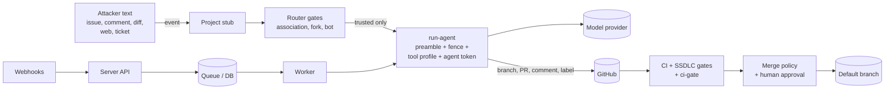

# Threat model

This is the threat model for Agent Squad HQ itself: the hub workflows, the composite actions, the `squadhq` package, server mode and the client apps. It uses STRIDE for the system and the [OWASP Top 10 for LLM Applications (2025)](https://genai.owasp.org/llm-top-10/) for the model-specific risks. It is reviewed when the architecture changes and before each release.

The controls referred to here are described in the [security model](security-model.md). **Residual risks are stated plainly**: they are the things a careful operator still has to think about.

## Assets

| Asset | Why it matters |
|---|---|
| Project source code and default branches | The squad writes to them; a malicious merge is a supply-chain compromise of everything you ship |
| The hub repository | It holds the prompts, policy and workflows every project runs. Control of the hub is control of every project |
| `SQUADHQ_APP_PRIVATE_KEY` | Mints tokens for every repository the App is installed on |
| The token broker (token-broker mode) | Holds the App keys in place of your organisation; mints tokens for every tenant that installed its Apps |
| GitHub Actions OIDC tokens (token-broker mode) | A job's OIDC token is what the broker trades for an App token, for about five minutes after it is issued |
| Model credentials | Direct cost; some can read prompts and outputs on the provider side |
| Deploy secrets (optional) | Production access |
| Agent transcripts, briefs, reports | May contain code, internal plans and personal data |
| Server database and audit log | Approvals, run history, evidence |
| Budget | Unbounded model spend is a real harm |

## Actors

| Actor | Assumed capability |
|---|---|
| External attacker | Can open issues, comment, open fork PRs, publish web pages and packages an agent may read, and send webhook requests to a public server |
| Low-privilege contributor (`CONTRIBUTOR`, `FIRST_TIME_CONTRIBUTOR`) | As above, with a history in the repository |
| Trusted member | Can trigger agents. May be careless or have a compromised account |
| A manipulated model | Will do whatever the injected text says, within the tools it was given |
| Compromised dependency or action | Runs code in a runner or the server |
| Organisation owner / hub maintainer | **Trusted.** Out of scope as an attacker |

## Data flow

## STRIDE

| ID | Threat | Example | Mitigations | Residual risk |
|---|---|---|---|---|
| S1 | **Spoofing** a trusted author | An outsider's comment is treated as a member's | GitHub's `author_association` decides eligibility in workflow conditions; bots are excluded by `user.type`; the squad's own issues need the bot login **and** an `Originated-by:` line | A compromised member account is trusted. Use SSO and 2FA in your organisation |
| S2 | Spoofing a webhook (server) | Forged Jira or GitHub delivery | Per-source signature verification; deliveries are rejected without a configured secret; delivery-id de-duplication | Jira, Trello and GitLab carry no association, so trust rests on `SQUADHQ_TRUSTED_ACTORS` being set correctly |
| S3 | Spoofing the bot | A user named like the bot, or the agent forging an ops marker | Bot checks compare the exact configured login and account type; agents run as a **separate agent App**, and protocol markers, ledger lines and trivial-lane authorship are trusted only from the ops App | In single-app mode agents share the ops login; unattended merges are then disabled, but markers cannot be told apart |
| T1 | **Tampering** with the default branch | Agent pushes to `main`, force-pushes, or approves and merges its own PR | No profile grants it; branch guard hook and git wrapper; the `squadhq` ruleset (no force push, PR required, one approval after the last push, `hub / ci-gate` required, no bypass actors). The agent App lacks merge rights in practice: its own approval never satisfies the ruleset | If the ruleset is missing or edited, the hook is the only barrier. `squadhq doctor --check rulesets` |
| T2 | Tampering with policy through a PR | A PR edits `config/flows.yml`, `prompts/` or workflows in the **hub** | Agents work in project repos with a token for that repo only; CI/CD paths force `risk:high` | A human approving a malicious hub PR. Protect the hub's default branch and review hub changes |
| T3 | Tampering with the merge decision | Injected text makes the Reviewer apply `risk:low` and `ready-to-merge` | The deterministic risk floor; `merge_policy.auto_merge` ships disabled; the default mode needs a human approval; `always_human` areas; the approval that satisfies the ruleset comes from the ops App only after the policy passes; single-app mode disables unattended merges | If you enable `risk_based`/`auto`, a manipulated Reviewer can still approve a change whose paths all fall outside the floor and `always_human`. Keep `approvers` unless the floor and your packs' `risk_paths` cover what matters to you |
| T4 | Tampering with the audit log (server) | Editing `audit_events` | Hash chain; `/audit/verify`; export to write-once storage | Someone with database write access can rewrite the whole chain consistently. Export regularly |
| R1 | **Repudiation** | "The agent did it" | Every bot action is attributable to the App; workflow logs; cost-ledger lines with run ids; server audit events | Actions logs expire with your retention settings |
| I1 | **Information disclosure** of secrets to a model | Agent reads a token from the environment or `.git/config` | `persist-credentials: false`; the agent token is scoped to one repository and expires within an hour; the bookkeeping token is never passed to the agent | The agent token is in the agent's environment (`GH_TOKEN`) by design. A manipulated agent can use it within its scope |
| I2 | Exfiltration through tools | `curl` to an attacker host | `curl`, `wget` and most `gh api` calls are denied; web tools are off unless a role adds them | See "allow-pattern limits" below: an allowed build command can run code that makes network calls. GitHub-hosted runners have open egress |
| I3 | Disclosure through logs | Full transcripts in a public repo's logs | `show_agent_transcripts: false` by default; gitleaks `--redact` | Model output posted as comments is public on public repositories |
| I4 | Disclosure to fork PRs | Secrets in fork workflows | Fork PRs never reach agent jobs; `ci-gate` uses only `GITHUB_TOKEN` | Low |
| D1 | **Denial of service / cost** | Comment floods, ticket floods | Trigger gates; concurrency groups; WIP limit; flood guards; hub-loop monthly cap; capacity breaker | Trusted members can still trigger many coding runs, and coding runs are not capped by the monthly budget. Set a provider-side limit |
| D2 | Scheduler gaps | GitHub cron runs late or not at all | Stuck sweeper and ticket transitions recover; `workflow_dispatch` on every schedule | Delays of hours are possible in Actions mode |
| E1 | **Elevation** through tool allowlist gaps | Using an allowed prefix to run something else | Profiles defined once; extras validated; final filter drops unrestricted shells; denies beat allows | See "allow-pattern limits" |
| E2 | Elevation through the label guard | Agent applies `agent:implement` or `ready-to-merge` it does not own | `gh` wrapper refuses; downstream jobs re-check conditions | The guard is advisory (see below) |
| E3 | Elevation via a compromised action or dependency | A tag is moved on a third-party action | Actions pinned to commit SHAs (CI-enforced); scanner downloads verified by SHA-256; Dependabot with a 7-day cooldown | See [supply chain](supply-chain.md): the package's own Python dependencies are not hash-pinned in workflows yet |
| E4 | Elevation through the token broker | An agent job requests an OIDC token and trades it for an ops token | Token-broker mode only. `id-token: write` only on jobs that mint tokens; agent and untrusted-code jobs, and callers of `agent-exec.yml`, never get it; the agent job holds only what it holds in App-key mode (the agent token and a `contents: read` hub token); the isolation lint fails CI on any of these | Code running in a prep, post or deterministic job can request its own OIDC token and ask the broker for an ops token with the App's **full** permissions; the narrowing is chosen by the client, not enforced against the job. Those jobs run only hub code |

## Token-broker mode

With `vars.SQUADHQ_TOKEN_BROKER` set ([ADR-0011](../adr/0011-token-broker-mode.md)), the App keys leave your organisation and a broker mints the tokens. That removes the most valuable secret from GitHub and adds a new trusted party. The risks, and what limits them:

| Risk | Example | Mitigations | Residual risk |
|---|---|---|---|
| **OIDC audience confusion** | A job's OIDC token, issued for the broker, is replayed at another relying party that trusts GitHub OIDC (a cloud account, another broker), or a token minted for that other service is replayed at the broker | The client requests a dedicated audience (`SQUADHQ_TOKEN_BROKER_AUDIENCE`, default the broker URL) and sends the token only to the configured https URL, with redirects refused; the broker must reject any other `aud`, check `iss`, `exp`, `nbf` and the signature against GitHub's JWKS. Cloud trust policies elsewhere must also pin their own audience and subject | A relying party that does not check the audience accepts the broker token. Review every OIDC trust you have (AWS, Azure, GCP, Vault) for an audience and subject condition before turning broker mode on |
| **`job_workflow_ref` trust** | A workflow the broker trusts by repository name is edited, or an attacker's workflow in an enabled project asks for an ops token | The broker accepts only the registered hub and enabled projects (`repository_id`, `repository_owner_id`), and only when `job_workflow_ref` points at the hub's (or the publisher's) workflow files, so a project's own workflows cannot mint tokens; the hub's default branch is protected and changes to `.github/` are `risk:high` | `job_workflow_ref` names a file and a ref, not a reviewed commit: anyone who can change the hub's workflows (or push a ref the broker accepts) can mint tokens. Protect the hub like a deploy key, and prefer a broker that pins refs (`refs/heads/main`, release tags) |
| **Broker compromise** | An attacker controls the broker or its App keys | Out of the workflows' reach: the broker is the key holder. GitHub-side controls still apply to every token it issues: the `squadhq` ruleset (one human approval after the last push, `hub / ci-gate`, no bypass), the agent App's narrow permissions, token expiry within the hour, App installation scoped to selected repositories | A compromised broker can mint ops and agent tokens for **every tenant** that installed its Apps, up to the Apps' permissions: open and approve PRs, write issues, edit workflows (ops App), read private code. Choose a broker operator you trust as you would trust someone holding your App keys; install its Apps on selected repositories only; uninstalling the Apps revokes everything at once |
| **Broker outage** | The broker is down or rate-limits | Clear failure: the mint step fails with the broker's error code; usage reporting is best effort and never fails a run | Every job that needs a token fails while the broker is unavailable. Delete `SQUADHQ_TOKEN_BROKER` and restore the App keys to fall back |
| **Broader or longer-lived tokens than App-key mode** | A broker step asks for more than its App-key sibling, or a token outlives its job | Every request carries the App-key path's permission set (the broker may only narrow; a test compares each broker step with its sibling); each minting job ends with an `always()` step that revokes the tokens it minted; the agent's hand-off tokens are revoked by the post job | A job killed before its last step leaves its tokens valid until they expire (within the hour), as with a skipped post step in App-key mode |

## OWASP Top 10 for LLM Applications

| Risk | How it applies | Mitigations | Residual risk |
|---|---|---|---|
| **LLM01 Prompt injection** | Every issue, comment, diff, file and web page an agent reads | Preamble and fencing; trigger eligibility in code; least-privilege tools and tokens; no merge or deploy capability; risk floor; human approval by default; red-team evals | Fencing reduces but cannot eliminate injection. Assume an agent **can** be steered within its tools, and size its tools accordingly |
| **LLM02 Sensitive information disclosure** | Agents see source code and may echo secrets they find | gitleaks on every PR; transcripts off; repo-scoped tokens | A model can paste file contents into a comment. Do not run the squad on repositories whose contents must never appear in issue comments |
| **LLM03 Supply chain** | Model providers, Claude Code action, scanners, packs, skills | Pinned action SHAs, verified downloads, packs and skills reviewed as code, evals on prompt changes | Provider-side model changes can alter behaviour without a code change; evals are the guard |
| **LLM04 Data and model poisoning** | `docs/lessons.md`, `CLAUDE.md`, ADRs feed future runs | Memory files are trusted only as they are on the integration branch, never as changed by the PR under review; the Lessons Harvester proposes changes as PRs a human merges | A poisoned lesson merged by a human persists |
| **LLM05 Improper output handling** | Model output becomes labels, comments, branch names, shell input | Hub-loop actions limited to five types, each checked against role authority; merge-policy `reason` passed through `env:`; workflow inputs validated by regex | Comments are rendered Markdown; links in them are not sanitised |
| **LLM06 Excessive agency** | Agents with write tools | Four tool profiles; per-role push scopes; label guard; no merge, deploy, release, settings or secrets access; bounded loops | Edit profiles can run the packs' build and test commands, which execute repository code the agent may have changed |
| **LLM07 System prompt leakage** | Prompts are public in this repository | Nothing secret is placed in prompts; credentials are environment variables | None by design |
| **LLM08 Vector and embedding weaknesses** | No retrieval store is used | | Not applicable today |
| **LLM09 Misinformation** | Wrong code, wrong reviews, wrong legal or financial summaries | CI and gates, independent Reviewer, human approval, "not a lawyer" framing for Legal, drafts-only for Growth and SEO | Reviews can miss defects. Treat agent PRs like any contributor's |
| **LLM10 Unbounded consumption** | Runaway loops and costs | Review-fix round cap, flood guards, WIP limit, concurrency groups, hub-loop budget cap, capacity breaker, retry caps | Coding-agent spend is recorded but not capped; per-run and per-project budgets are not enforced yet |

## Known residual risks

These are the limits of the current controls. They are not bugs to report unless you can show an exploit that goes further than described.

1. **Allow-pattern suffix limits.** Claude Code allow rules are prefix patterns. `Bash(git push origin HEAD:refs/heads/agent/*)` cannot express "and nothing after the refspec", so a second refspec or extra flags may match the pattern. The branch guard hook and the default-branch ruleset are the backstops for pushes. Likewise, `Bash(npm run *)` or `Bash(./gradlew *)` from a pack lets the agent run any script or task, **including ones it has just edited**, which is equivalent to arbitrary code execution inside the runner with the agent token in the environment. The containment is the token's scope (one repository, least permissions, short lifetime), the ephemeral runner, and the fact that nothing reaches the default branch without the gates and a merge decision.
2. **The label guard is advisory.** It wraps `gh` on `PATH`. An absolute path to `gh`, or any other way of reaching the GitHub API with the agent token, bypasses it, and the install step is `continue-on-error`. Labels only start deterministic jobs, which re-check their own conditions, but a stray `agent:implement` can still start paid work.
3. **Executors other than Claude Code have no per-command allowlist.** The tool-profile translations for Codex CLI (`--sandbox workspace-write`, network access on), aider (no tool allowlist) and Gemini CLI (an approximate tool list) are weaker than Claude Code's. They are not runnable in Actions mode today; if you wire one up, push scope rests on the token and branch protection alone.
4. **Open egress on GitHub-hosted runners.** Denying `curl` and `wget` does not stop network access from build scripts or language runtimes. Server `worker` mode can restrict egress, but only if you put the job network behind an egress proxy or firewall.
5. **Trusted members are trusted.** Anyone with an allowed association can start agent runs and steer them with their own text. A compromised member account is a direct path to paid runs and agent PRs (which still need an approval to merge).
6. **Prompt-level limits.** Some limits are enforced only in prompts, for example the review-fix round cap and several flood guards. `config/flows.yml` records which ones (`source:` and `enforced_by:` fields).
7. **Configuration that looks enforced but is not.** Some `squadhq.yml` keys are validated but reserved for server mode (per-run and per-project budgets, `on_exceed` other than pause, release strategy, `require_security_agent`, non-issue notification channels). The schema marks them RESERVED and `squadhq render`/`squadhq doctor --check reserved` warn when they are set. Do not rely on them as controls.
10. **Single-app mode.** With one App, agents and bookkeeping share an identity: an agent can post text that looks like a protocol marker. Unattended merges are disabled in that mode, but state handling (sweeper, ledger) can be confused. Use two Apps for anything beyond a trial.
8. **Unpinned Python dependencies at run time.** `setup-hub` installs the hub package with `pip`; without a hashed lock file in the hub, its dependency (PyYAML) resolves at run time within the declared range.
9. **GitHub cron reliability** affects timeliness, not integrity.
11. **Hand-off key material in agent-job memory (accepted).** The prep job seals the agent's tokens with a key derived (HKDF-SHA256) from `SQUADHQ_HANDOFF_KEY`, or from the LLM credential when that secret is not set; the agent job must hold that secret to unseal them. Code running in an agent job could read it from runner memory and, on a **public** repository where workflow artifacts are downloadable, decrypt the prep artifacts of *concurrent* runs during their short window (artifacts are deleted by the post job and expire after one day; tokens are revoked by the post job and expire within the hour). Set a dedicated `SQUADHQ_HANDOFF_KEY`, keep the hub private, or use server mode / self-hosted runners for high-assurance deployments.
12. **Re-runs.** Because the post job revokes the agent's tokens and deletes the hand-off, a failed agent job cannot be retried alone: re-run the whole workflow run (the failure handler does this through `/rerun`).
13. **Fork approval by timeline.** `fork:approved` provenance is read from the PR timeline (non-bot actor, after the current head's `committed` event and commit date). Commit dates are author-supplied; the required human approval in the ruleset remains the primary control for forks.
14. **Token-broker mode trusts the broker.** See [Token-broker mode](#token-broker-mode): the broker can mint tokens for every repository its Apps are installed on. Any job holding `id-token: write` could ask it for an un-narrowed ops token.

## Review triggers

Update this document when you add a trigger, a tool to a profile, a token scope, a new runtime or executor, a new external input (tracker, webhook source, web tool), or a change to the merge path.
